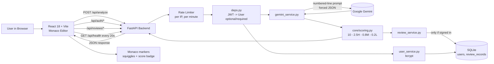
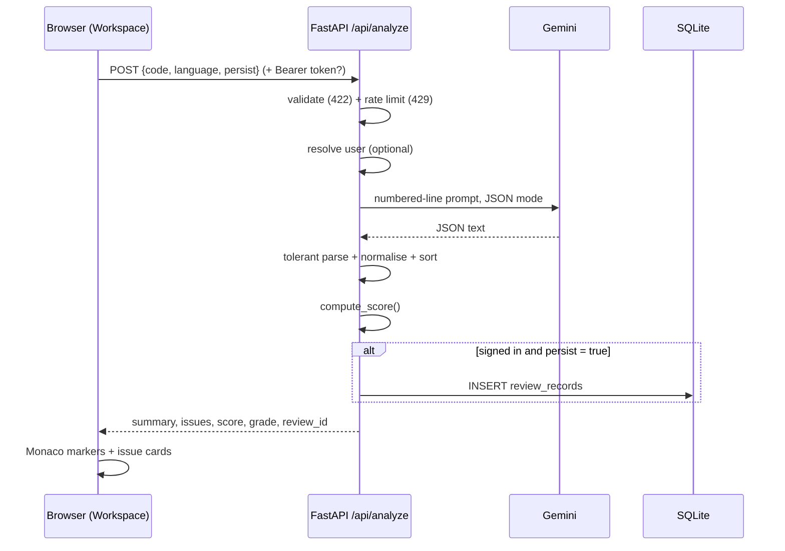
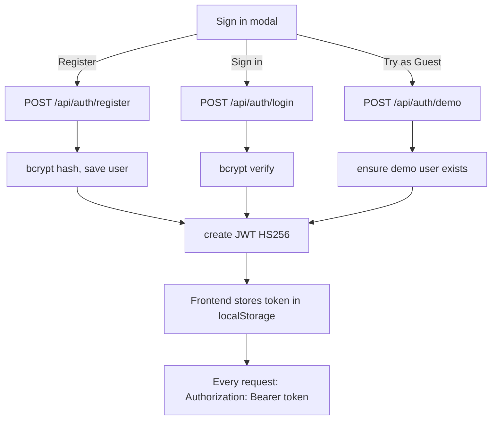
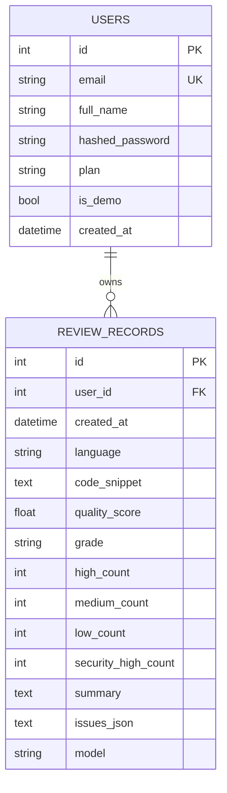

# CodeSense AI: Project Details

**AI-powered code review platform**
Final-year capstone project by **Nitish Singh**

This document explains what the project does, how it works inside, and how to run and present it.
Everything here is based on the actual code in `backend/` and `frontend/src/`.

---

## Table of Contents

1. [Project Overview & Problem Statement](#1-project-overview--problem-statement)
2. [Features](#2-features)
3. [Tech Stack](#3-tech-stack)
4. [System Architecture](#4-system-architecture)
5. [Working / Request Flow](#5-working--request-flow)
6. [Database Schema](#6-database-schema)
7. [API Reference](#7-api-reference)
8. [Folder Structure](#8-folder-structure)
9. [Security Measures](#9-security-measures)
10. [Testing](#10-testing)
11. [How to Run on Localhost](#11-how-to-run-on-localhost)
12. [Demo Script (5 minutes)](#12-demo-script-5-minutes)
13. [Comparison with Market Products](#13-comparison-with-market-products)
14. [Future Improvements](#14-future-improvements)
15. [Limitations](#15-limitations)
16. [Viva Q&A](#16-viva-qa)

---

## 1. Project Overview & Problem Statement

### The problem

- Code review is slow. A senior developer has to read every line by hand.
- Students and junior developers often don't have a senior reviewer at all.
- Many bugs and security holes (SQL injection, hardcoded passwords, XSS) reach production because nobody caught them.
- Traditional linters only find simple rule-based issues. They don't explain *why* something is wrong in plain English.

### The solution: CodeSense AI

CodeSense AI is a web app where you **paste code and get an instant, senior-level review**.

- It uses **Google Gemini** (a Large Language Model) to find **bugs, security issues, performance problems, and style issues**.
- Each issue is shown **on the exact line** in a VS Code-style editor (Monaco), with red/amber squiggly underlines.
- Each issue comes with a **plain-English explanation** and a **suggested fix** you can copy or apply.
- The app computes a **deterministic quality score (0–10) and a letter grade (A+ to F)**.
- Signed-in users get a **personal dashboard** with history, charts, and KPIs.

### Who is it for?

- Students learning to write secure, clean code.
- Developers who want a quick second opinion before committing.
- Small teams without a dedicated reviewer.

> **Viva tip:** "Sir, problem yeh hai ki manual code review slow hai aur har kisi ke paas senior reviewer nahi hota. CodeSense AI ek AI reviewer deta hai jo line-by-line issue batata hai, explain karta hai, aur fix bhi suggest karta hai."

---

## 2. Features

All features below exist in the current code.

### Review Workspace (`/`)

| Feature | What it does | Where in code |
|---|---|---|
| Monaco code editor | Same editor engine as VS Code. Syntax highlighting, dark theme. | `components/CodeInput.jsx` |
| Language selector | Python, JavaScript, TypeScript, Java, C++, Go, Auto-detect | `CodeInput.jsx`, `schemas/analyze.py` |
| 5 sample snippets | Python (security bugs), Python (clean), JavaScript (XSS + async bug), JavaScript (clean), Java (NullPointer + resource leak) | `CodeInput.jsx` |
| AI analysis | Sends code to backend, which asks Gemini for a review | `pages/Workspace.jsx`, `routers/analyze.py` |
| Inline diagnostics | Red (high), amber (medium), info (low) squiggles on the exact lines. Hover shows title + explanation. | `Workspace.jsx` (`applyMarkers`) |
| Line badge jump | Click the `L7` badge on an issue card: editor scrolls to that line and highlights it for 3 seconds | `IssueCard.jsx`, `Workspace.jsx` (`handleLineClick`) |
| Quality score + grade | 0–10 score and A+…F grade, coloured by severity | `core/scoring.py`, `lib/score.js`, `ScoreBadge.jsx` |
| Issue cards | Type chip (`!!` bug, `SEC` security, `PFM` performance, `STL` style), severity badge, expandable explanation and fix | `IssueCard.jsx` |
| Copy fix | One click copies the suggested fix to clipboard | `IssueCard.jsx` |
| Apply fix + Diff view | "apply fix" replaces the issue's line with the suggested fix in a working copy, then opens a side-by-side Monaco **DiffEditor** (original vs AI-suggested). You can "apply to editor", "reset", or "close diff". | `Workspace.jsx` (`replaceLine`, `handleApplyFix`), `CodeInput.jsx` |
| Export report | Downloads a Markdown (`.md`) report with score, summary, every issue + fix, and the reviewed code | `lib/report.js` |
| Keyboard shortcuts | `Ctrl/Cmd + Enter` = analyze, `?` = shortcuts help, `Esc` = close | `Workspace.jsx`, `ShortcutsModal.jsx` |
| 20,000 character limit | Shown as a counter in the toolbar. Analyze button disables when over limit. Backend also enforces it. | `CodeInput.jsx`, `schemas/analyze.py` |
| Status bar | Model name, scan count, score, error count, character count, language | `Workspace.jsx` |

### Accounts & Auth

| Feature | What it does |
|---|---|
| Register / Sign in | Email + password, in a modal with two tabs |
| **Try as Guest** | One click logs you into a shared demo account. No typing needed. Best for examiners. |
| Session persistence | JWT token stored in `localStorage`. Checked with `/api/auth/me` on page load. |
| Auto logout on 401 | If any request returns 401, the app logs out and re-opens the sign-in modal |
| User menu | Avatar with initials, plan badge, links to Dashboard / Workspace, Sign out |

### Executive Dashboard (`/dashboard`)

| Widget | Shows |
|---|---|
| KPI cards | Total reviews, average quality score (and best score), critical vulnerabilities prevented (high-severity security findings), clean pass rate |
| Score distribution chart | How many reviews fall in each grade band (A+, A, B, C, D, F) |
| Activity sparkline | Number of reviews per day for the last 14 days (hand-drawn SVG) |
| Language breakdown | Reviews per language with average score |
| Audit history table | Every past review: time, language, code preview, score, issue count. **"View report"** reopens it in the workspace with all markers restored. Delete button removes a record. |
| Gated view | If not signed in, shows a "Sign in" call-to-action instead of data |

### Other

- **Live status pill** in the top bar. Polls `/api/health` every 20 seconds and shows "AI Engine: Active" plus the **real measured p99 latency** from the backend.
- **Trust bar** strip with security/privacy badges.
- **Swagger API docs** at `/docs` (auto-generated by FastAPI).

> **Viva tip:** "Main feature hai ki issues seedha editor ke andar line pe dikhte hain, VS Code jaisa. Aur 'apply fix' karke diff view mein before/after dekh sakte hain."

---

## 3. Tech Stack

| Layer | Technology | Why this choice |
|---|---|---|
| Frontend framework | **React 18** | Component-based UI, huge ecosystem |
| Build tool | **Vite 8** | Very fast dev server and build |
| Routing | **react-router-dom 6** | `/` (Workspace) and `/dashboard` pages |
| Code editor | **@monaco-editor/react** (Monaco) | Same editor as VS Code; supports markers (squiggles) and diff view |
| Styling | Hand-written CSS (`App.css`) | No Tailwind / no UI library; full control over design |
| HTTP client | Native `fetch` wrapper (`api.js`) | No axios needed; small surface |
| Backend framework | **FastAPI** | Async, fast, auto Swagger docs, type-checked with Pydantic |
| ASGI server | **Uvicorn** | Runs FastAPI |
| Validation | **Pydantic v2** + **pydantic-settings** | Request/response schemas and typed config |
| ORM / DB | **SQLAlchemy 2.0 (async)** + **aiosqlite** + **SQLite** | Non-blocking DB access; SQLite needs no server |
| Password hashing | **bcrypt** (cost 12) | Industry standard slow hash |
| Tokens | **python-jose** (JWT, HS256) | Stateless authentication |
| Email validation | **email-validator** | Rejects bad emails at the schema level |
| AI model | **Google Gemini** via `google-genai` (async client) | Primary `gemini-3.1-flash-lite`, fallback `gemini-3.5-flash-lite` |
| Config | **python-dotenv** + `.env` | Keeps API keys out of code |
| Testing | **pytest**, **pytest-asyncio**, **httpx** | Async API tests against the real app |

> **Viva tip:** "FastAPI isliye liya kyunki yeh async hai, toh Gemini ka wait karte waqt server block nahi hota. Aur Swagger docs free mein mil jaate hain."

---

## 4. System Architecture

### ASCII diagram

```
+--------------------------------------------------------------+
|                    BROWSER  (localhost:5173)                  |
|  React 18 + Vite                                              |
|                                                               |
|  +-------------+   +------------------+   +----------------+  |
|  |  TopBar     |   |  Workspace (/)   |   | Dashboard      |  |
|  |  LiveStatus |   |  Monaco editor   |   | (/dashboard)   |  |
|  |  UserMenu   |   |  ResultsPanel    |   | KPIs, charts,  |  |
|  +-------------+   |  IssueCards      |   | Audit table    |  |
|                    +------------------+   +----------------+  |
|        AuthContext (user + JWT in localStorage)               |
|        api.js  (fetch wrapper, adds "Authorization: Bearer")  |
+-------------------------------|------------------------------+
                                | HTTP / JSON  (CORS allowed)
                                v
+--------------------------------------------------------------+
|                 FASTAPI BACKEND  (localhost:8000)             |
|                                                               |
|  Middleware: CORS  |  timing + latency metrics                |
|                                                               |
|  Routers:  /api/auth/*      /api/analyze     /api/reviews/*   |
|            /api/health      /docs (Swagger)                   |
|     |            |                |                |          |
|     v            v                v                v          |
|  RateLimiter   deps.py (JWT -> current user)                  |
|                                                               |
|  Services:  user_service   gemini_service   review_service    |
|  Core:      security (bcrypt, JWT)   scoring   metrics        |
+--------|-------------------------|---------------------|------+
         |                         |                     |
         v                         v                     v
+------------------+    +-----------------------+   (same DB)
|  SQLite          |    |  Google Gemini API    |
|  database.db     |    |  gemini-3.1-flash-lite|
|  users,          |    |  fallback:            |
|  review_records  |    |  gemini-3.5-flash-lite|
+------------------+    +-----------------------+
```

### Mermaid flowchart



> **Viva tip:** "Teen layers hain: React frontend, FastAPI backend, aur do external cheezein: Gemini AI aur SQLite database. Frontend sirf backend se baat karta hai, Gemini key kabhi browser mein nahi jaati."

---

## 5. Working / Request Flow

### (a) Analyze flow (the main feature)

1. **User writes or pastes code** in the Monaco editor and selects a language (or "Auto-detect").
2. **User presses `Ctrl + Enter`** (or clicks "analyze"). `Workspace.jsx` clears old markers and calls `analyzeCode()` in `api.js`.
3. **Frontend sends `POST /api/analyze`** with JSON `{ code, language, persist }`.
   - `persist` is `true` only if the user is signed in.
   - If a JWT exists in `localStorage`, it's added as `Authorization: Bearer <token>`.
4. **Request validation** (`schemas/analyze.py`): code must not be empty and must be at most 20,000 characters. Language must be one of the allowed values. Otherwise FastAPI returns **422**.
5. **Rate limit check** (`core/ratelimit.py`): max **30 analyze requests per minute per IP** (fixed 60-second window). Over the limit returns **429** with a `Retry-After` header.
6. **Optional user lookup** (`deps.py` → `get_current_user_optional`): if a valid token is present, we get the `User`. If there is no token or it is invalid, we just continue as **anonymous**. Analyze works for everyone.
7. **Gemini call** (`services/gemini_service.py`):
   - **Numbered-line prompt:** each line of code is sent with its line number on the left (`   7  query = ...`). This helps Gemini report **accurate line numbers**.
   - **System prompt** asks the model to act like a principal engineer and return **only one JSON object** with `summary` and an `issues` list (each issue has `line`, `type`, `severity`, `title`, `explanation`, `suggested_fix`).
   - **Forced JSON:** `response_mime_type="application/json"`, `temperature=0.2` (low randomness), `max_output_tokens=4096`.
   - **Timeout:** 45 seconds (configurable).
   - **Model fallback:** tries the last model that worked, then the primary `gemini-3.1-flash-lite`, then the fallback `gemini-3.5-flash-lite`. It only moves to the next model for "model not available" type errors (404, not found, unsupported...). A bad key, quota error, or timeout stops immediately with a clear message.
   - **Tolerant parsing:** if the JSON is wrapped in ```` ```json ```` fences or has extra text, the parser strips fences and slices from the first `{` to the last `}`.
   - **Normalisation:** synonyms are mapped to fixed values (e.g. `critical`/`blocker` → `high`, `warning` → `medium`, `vulnerability`/`xss` → `security`). Line values like `"line 7"` become `7`. Missing fields get safe defaults. Long text is trimmed.
8. **Sorting** (`routers/analyze.py`): issues are sorted by
   1. severity: high → medium → low
   2. type: security → bug → performance → style
   3. line number (issues without a line go last)
9. **Deterministic score** (`core/scoring.py`):

   ```
   score = 10 − (2.5 × high) − (0.8 × medium) − (0.2 × low)
   clamped to [0, 10], rounded to 1 decimal
   ```

   | Score | Grade | Meaning |
   |---|---|---|
   | ≥ 9.5 | **A+** | Production ready |
   | ≥ 8.5 | **A** | Ship with minor cleanup |
   | ≥ 7.0 | **B** | Solid, needs polish |
   | ≥ 5.5 | **C** | Needs attention |
   | ≥ 3.5 | **D** | High risk |
   | < 3.5 | **F** | Critical, do not ship |

   Example: 1 high + 1 medium → 10 − 2.5 − 0.8 = **6.7 → grade C**.
   The score is calculated by our own formula, **not by the AI**, so the same issue counts always give the same score. The frontend (`lib/score.js`) uses the exact same formula.
10. **Save to history (only if signed in and `persist` is true)** (`services/review_service.py`): a `ReviewRecord` row is saved with the code, score, grade, severity counts, high-severity security count, summary, the full issues JSON, and the model name. If saving fails, the review is **still returned** (history is a bonus, not a requirement).
11. **Response** `AnalyzeResponse`: `summary`, `issues`, `issue_count`, `quality_score`, `grade`, `model`, `review_id` (null for anonymous users).
12. **Frontend shows the results:**
    - `applyMarkers()` puts **Monaco markers** on each issue line: high = Error (red), medium = Warning (amber), low = Info.
    - The results panel shows the score badge, summary, and the sorted issue cards.
    - If the user edits the code, the old markers are cleared (they would be out of date).



> **Viva tip:** "Score AI se nahi aata, hamara apna formula hai: 10 minus 2.5 per high, 0.8 per medium, 0.2 per low. Isliye score deterministic hai, same input pe same score."

### (b) Auth flow

1. **Register** (`POST /api/auth/register`):
   - Email must be valid. Full name 1–120 characters. Password 8–128 characters with **at least one letter and one digit**.
   - Email is lower-cased. Password is hashed with **bcrypt (cost 12)**.
   - Duplicate email → **409 Conflict**.
   - Returns `201` with `access_token`, `token_type: "bearer"`, `expires_in`, and the user profile (never the password hash).
2. **Login** (`POST /api/auth/login`):
   - Looks up the user by email and checks the password with `bcrypt.checkpw`.
   - Wrong email or password → **401** with the same message ("Incorrect email or password"), so attackers can't tell which one was wrong.
   - Even when the email doesn't exist, a dummy bcrypt check still runs so the response time stays similar (prevents user enumeration by timing).
3. **Try as Guest** (`POST /api/auth/demo`):
   - No body needed. The backend creates the shared demo account the first time (marked `is_demo = true`, plan "Developer Pro (Demo)") and reuses it after that.
4. **JWT token** (`core/security.py`):
   - Algorithm **HS256**, signed with `SECRET_KEY`.
   - Claims: `sub` (user id), `email`, `type: "access"`, `iat` (issued at), `exp` (expiry). Default lifetime is **7 days**.
5. **Using the token:** `api.js` adds `Authorization: Bearer <token>` to every request. `deps.py` decodes it, checks signature, expiry, and `type`, then loads the user from the DB. If the user no longer exists, the token is rejected.
6. **On page reload:** `AuthContext` calls `GET /api/auth/me` to check the stored token. If it fails, the user is logged out.
7. **On any 401:** `api.js` fires a `codesense:unauthorized` event; `AuthContext` logs out and shows "Your session expired" in the sign-in modal.



> **Viva tip:** "Password kabhi plain text mein store nahi hota, bcrypt hash hota hai. Login ke baad JWT milta hai, jo har request ke header mein jaata hai. Server stateless hai, session table nahi hai."

### (c) Dashboard stats flow

1. User opens `/dashboard`. If not signed in, a "Sign in" prompt is shown instead.
2. If signed in, `Dashboard.jsx` calls **two endpoints in parallel** (`Promise.all`):
   - `GET /api/reviews/stats`
   - `GET /api/reviews?limit=100`
3. Both endpoints require a valid JWT (`get_current_user`, else 401).
4. `review_service.compute_stats()` loads **only this user's** review records and calculates:
   - `total_reviews`
   - `average_quality_score` and `best_score`
   - `critical_vulnerabilities_prevented` = sum of high-severity **security** findings
   - `clean_pass_rate` = reviews with zero issues ÷ total reviews
   - `total_issues_found`
   - `score_distribution`: count of reviews in each grade band (A+, A, B, C, D, F)
   - `by_language`: count and average score per language
   - `activity`: reviews per day for the **last 14 days**
   - `last_review_at`
5. The frontend renders KPI cards, the distribution chart, the sparkline, the language breakdown, and the audit table.
6. **View report:** clicking it navigates to `/` with the review id. The workspace calls `GET /api/reviews/{id}` and restores the code, language, results, and Monaco markers exactly as they were.
7. **Delete:** the row disappears immediately (optimistic update), then `DELETE /api/reviews/{id}` is called and stats are refreshed. If the delete fails, the row comes back.

> **Viva tip:** "Dashboard ka saara calculation backend pe hota hai, aur har query user_id se filter hoti hai, isliye ek user dusre user ka data kabhi nahi dekh sakta."

---

## 6. Database Schema

Database: **SQLite** file `backend/database.db` (async via `aiosqlite`).
Tables are created automatically on startup (`db.init_db()` → `Base.metadata.create_all`).
SQLite settings applied on every connection: `PRAGMA foreign_keys=ON` and `PRAGMA journal_mode=WAL`.

### Table: `users`

| Column | Type | Constraints | Purpose |
|---|---|---|---|
| `id` | INTEGER | Primary key | User id (used as JWT `sub`) |
| `email` | VARCHAR(320) | Unique, indexed, not null | Login email (stored lower-case) |
| `full_name` | VARCHAR(120) | Not null | Display name |
| `hashed_password` | VARCHAR(255) | Not null | bcrypt hash (never plain text) |
| `plan` | VARCHAR(40) | Not null, default "Developer Pro" | Plan label shown in UI |
| `is_demo` | BOOLEAN | Not null, default false | True for the shared guest account |
| `created_at` | DATETIME (tz) | Not null, default UTC now | Sign-up time |

### Table: `review_records`

| Column | Type | Constraints | Purpose |
|---|---|---|---|
| `id` | INTEGER | Primary key | Review id |
| `user_id` | INTEGER | FK → `users.id` **ON DELETE CASCADE**, indexed, not null | Owner |
| `created_at` | DATETIME (tz) | Not null, default UTC now | When the review ran |
| `language` | VARCHAR(32) | Not null, default "auto" | Language selected |
| `code_snippet` | TEXT | Not null | Full submitted code (max 20,000 chars) |
| `quality_score` | FLOAT | Not null | 0–10 score |
| `grade` | VARCHAR(2) | Not null | A+, A, B, C, D, F |
| `high_count` | INTEGER | Not null, default 0 | High-severity issues |
| `medium_count` | INTEGER | Not null, default 0 | Medium-severity issues |
| `low_count` | INTEGER | Not null, default 0 | Low-severity issues |
| `security_high_count` | INTEGER | Not null, default 0 | High-severity **security** issues ("critical vulns prevented") |
| `summary` | TEXT | Not null | AI summary |
| `issues_json` | TEXT | Not null, default `[]` | Full issue list as JSON, used to restore the review exactly |
| `model` | VARCHAR(64) | Nullable | Gemini model that served the review |

**Composite index:** `ix_review_user_created` on (`user_id`, `created_at`) for fast "my history, newest first" queries.

### Relationship

```
users (1) ────────< (many) review_records
          user_id FK, ON DELETE CASCADE
```



> **Viva tip:** "Do tables hain: users aur review_records. One-to-many relation hai. User delete hua toh uske reviews bhi cascade se delete ho jaate hain."

---

## 7. API Reference

Base URL: `http://localhost:8000`. Interactive docs: `http://localhost:8000/docs`.

| Method | Endpoint | Auth required? | Rate limit | Purpose |
|---|---|---|---|---|
| GET | `/` | No | – | App name, version, author, links to docs and health |
| GET | `/api/health` | No | – | Liveness + measured latency (API and AI p50/p99) |
| POST | `/api/auth/register` | No | 15/min per IP | Create account, returns JWT + profile (201) |
| POST | `/api/auth/login` | No | 15/min per IP | Email + password → JWT + profile |
| POST | `/api/auth/demo` | No | 15/min per IP | One-click guest login → JWT + profile |
| GET | `/api/auth/me` | **Yes** | – | Current user's profile |
| POST | `/api/analyze` | **Optional** | 30/min per IP | Review code with Gemini. Saves to history only if signed in and `persist` is true |
| GET | `/api/reviews` | **Yes** | – | My review history (`limit` 1–200, default 50; `offset`) |
| GET | `/api/reviews/stats` | **Yes** | – | Dashboard KPIs + chart data |
| GET | `/api/reviews/{id}` | **Yes** | – | Full review (code + issues) for "View report". 404 if not mine. |
| DELETE | `/api/reviews/{id}` | **Yes** | – | Delete one of my reviews (204). 404 if not mine. |

### Example: `POST /api/analyze`

Request:

```json
{
  "code": "def f(a, b):\n    return a / b\n",
  "language": "python",
  "persist": true
}
```

Response (shape):

```json
{
  "summary": "…",
  "issues": [
    {
      "line": 2,
      "type": "bug",
      "severity": "medium",
      "title": "Possible division by zero",
      "explanation": "…",
      "suggested_fix": "…"
    }
  ],
  "issue_count": { "high": 0, "medium": 1, "low": 0 },
  "quality_score": 9.2,
  "grade": "A",
  "model": "gemini-3.1-flash-lite",
  "review_id": 12
}
```

### Error codes used

| Code | When |
|---|---|
| 401 | Missing / invalid / expired token on protected routes, or wrong login |
| 404 | Review not found (or belongs to another user) |
| 409 | Email already registered |
| 422 | Validation failed (empty code, too long, weak password, bad email) |
| 429 | Rate limit exceeded (`Retry-After` header included) |
| 500 | Unexpected server error during analysis |
| 502 | Gemini failed (bad key, timeout, invalid JSON, schema mismatch) |

> **Viva tip:** "Analyze endpoint pe login optional hai, guest bhi use kar sakta hai. Reviews wale saare endpoints pe JWT zaroori hai."

---

## 8. Folder Structure

```
CodeSenseAI/
├── README.md                    Short project readme
├── PROJECT_DETAILS.md           This document
│
├── backend/
│   ├── main.py                  FastAPI app: CORS, timing middleware, routers, /api/health
│   ├── db.py                    Async SQLAlchemy engine, sessions, SQLite pragmas, init_db
│   ├── deps.py                  Auth dependencies: get_current_user (required / optional)
│   ├── requirements.txt         Pinned runtime dependencies
│   ├── requirements-dev.txt     + pytest, pytest-asyncio, httpx
│   ├── pytest.ini               asyncio_mode = auto, testpaths = tests
│   ├── .env.example             Template for environment variables (copy to .env)
│   ├── database.db              SQLite file (created at runtime)
│   │
│   ├── core/
│   │   ├── config.py            Typed Settings (env / .env): JWT, DB, CORS, rate limits, Gemini
│   │   ├── security.py          bcrypt hashing, JWT create / decode
│   │   ├── scoring.py           Deterministic score + grade table
│   │   ├── ratelimit.py         In-memory fixed-window rate limiter (per IP)
│   │   └── metrics.py           Latency tracker (p50 / p95 / p99)
│   │
│   ├── models/                  SQLAlchemy ORM models
│   │   ├── base.py              Declarative Base + created_at helper
│   │   ├── user.py              User
│   │   └── review.py            ReviewRecord
│   │
│   ├── schemas/                 Pydantic request / response models
│   │   ├── analyze.py           AnalyzeRequest, Issue, AnalyzeResponse (20,000-char limit)
│   │   ├── auth.py              RegisterRequest (password policy), LoginRequest, UserOut, AuthResponse
│   │   └── review.py            ReviewListItem, ReviewDetail, ReviewStats, chart types
│   │
│   ├── routers/                 HTTP endpoints
│   │   ├── analyze.py           POST /api/analyze
│   │   ├── auth.py              /api/auth/register, login, demo, me
│   │   └── reviews.py           /api/reviews, /stats, /{id}
│   │
│   ├── services/                Business logic
│   │   ├── gemini_service.py    Prompt, Gemini call, fallback, tolerant JSON parsing
│   │   ├── review_service.py    Save reviews, history, dashboard statistics
│   │   └── user_service.py      Create user, authenticate, demo user
│   │
│   └── tests/                   pytest suite (29 tests)
│       ├── conftest.py          Fresh test DB per test, ASGI client, fake Gemini result
│       ├── test_scoring.py
│       ├── test_auth.py
│       ├── test_analyze.py
│       └── test_reviews.py
│
└── frontend/
    ├── index.html
    ├── package.json             React 18, react-router-dom, @monaco-editor/react, Vite
    ├── vite.config.js           Dev port 5173
    └── src/
        ├── main.jsx             React entry point
        ├── App.jsx              Router: "/" → Workspace, "/dashboard" → Dashboard, inside AuthProvider
        ├── App.css              Full design system
        ├── api.js               fetch wrapper: adds Bearer token, handles errors, 401 event
        ├── auth/
        │   └── AuthContext.jsx  User state, login / register / demo / logout, auth modal
        ├── pages/
        │   ├── Workspace.jsx    Editor + results, markers, apply fix, diff, export, shortcuts
        │   └── Dashboard.jsx    KPIs, charts, audit table
        ├── components/
        │   ├── TopBar.jsx       Brand, nav, live status, user menu
        │   ├── LiveStatus.jsx   Polls /api/health every 20 s
        │   ├── TrustBar.jsx     Security / privacy badges
        │   ├── CodeInput.jsx    Monaco editor, DiffEditor, language select, samples
        │   ├── ResultsPanel.jsx Score, summary, export, issue list
        │   ├── IssueCard.jsx    One issue: line badge, copy fix, apply fix
        │   ├── ScoreBadge.jsx   Score + grade display
        │   ├── SeverityBadge.jsx
        │   ├── Loader.jsx       Step-by-step loading animation
        │   ├── ShortcutsModal.jsx
        │   ├── auth/AuthModal.jsx         Sign In / Create Account / Try as Guest
        │   └── dashboard/
        │       ├── KpiCards.jsx
        │       ├── ScoreDistributionChart.jsx
        │       ├── ActivitySparkline.jsx
        │       ├── LanguageBreakdown.jsx
        │       └── AuditTable.jsx
        └── lib/
            ├── score.js         Same score formula as backend
            ├── report.js        Markdown report builder + download
            └── format.js        Time / language / grade formatting helpers
```

> **Viva tip:** "Backend layered hai: routers sirf HTTP handle karte hain, services mein logic hai, models mein DB tables, schemas mein validation. Isko separation of concerns bolte hain."

---

## 9. Security Measures

These are all actually implemented in the code:

| # | Measure | How | File |
|---|---|---|---|
| 1 | **API key never in code or browser** | `GEMINI_API_KEY` is read from `.env`. The app refuses to start without it. Only the backend calls Gemini. | `gemini_service.py`, `.env.example` |
| 2 | **Password hashing** | bcrypt with cost factor 12 and a random salt per password | `core/security.py` |
| 3 | **Long password safety** | bcrypt ignores bytes after 72. Longer passwords are first hashed with SHA-256 so the whole password counts. | `core/security.py` |
| 4 | **Password policy** | 8–128 chars, at least one letter and one digit | `schemas/auth.py` |
| 5 | **JWT authentication** | HS256 signed, has expiry (`exp`), and a `type: "access"` claim that is checked | `core/security.py`, `deps.py` |
| 6 | **Deleted-user tokens rejected** | Even a valid token fails if the user no longer exists in the DB | `deps.py` |
| 7 | **No user enumeration** | Same error for "wrong email" and "wrong password"; dummy bcrypt run keeps timing similar | `user_service.py`, `routers/auth.py` |
| 8 | **Data isolation per user** | Every review query filters by `user_id`. Another user's review returns 404, not 403, so its existence isn't leaked. | `review_service.py` |
| 9 | **Password hash never returned** | `UserOut` schema has no password field | `schemas/auth.py` |
| 10 | **Rate limiting** | 30/min for analyze, 15/min for auth endpoints, per client IP, returns 429 + `Retry-After` | `core/ratelimit.py` |
| 11 | **Input validation** | Pydantic: allowed languages only, code not empty, max 20,000 chars, valid email | `schemas/` |
| 12 | **SQL injection safe** | All DB access goes through SQLAlchemy ORM with bound parameters, no raw SQL strings | `services/` |
| 13 | **CORS allow-list** | Only localhost dev/preview origins (5173, 5174, 4173) are allowed | `core/config.py`, `main.py` |
| 14 | **Foreign keys enforced** | `PRAGMA foreign_keys=ON` so cascade deletes really work in SQLite | `db.py` |
| 15 | **Safe AI output handling** | AI response is parsed, validated, and normalised. Text fields are length-capped. Rendered as React text (not raw HTML), so no XSS from AI output. | `gemini_service.py`, `IssueCard.jsx` |
| 16 | **Weak secret warning** | Startup logs a warning if `SECRET_KEY` is shorter than 32 characters. If not set at all, a random key is generated per process. | `main.py`, `core/config.py` |
| 17 | **Anonymous reviews not stored** | Code from guests (not signed in) is never written to the database. Signed-in users can opt out with `persist: false`. | `routers/analyze.py` |
| 18 | **Secrets not committed** | Only `.env.example` with placeholder values is in the repo | `.env.example` |

> **Viva tip:** "Security ke liye: bcrypt hashing, JWT with expiry, rate limiting, Pydantic validation, ORM se SQL injection safe, aur har query user_id se filter hoti hai."

---

## 10. Testing

**Framework:** pytest + pytest-asyncio + httpx (`AsyncClient` with `ASGITransport`, so tests call the real FastAPI app in-process, no server needed).

**Test isolation** (`tests/conftest.py`):
- A separate test SQLite database is used. Tables are **dropped and recreated before every test**.
- Rate limiting is turned off for tests.
- **Gemini is never called.** The analyze tests replace `analyze_code` with a fake function that returns a fixed review (1 high security + 1 medium bug). So tests are fast, free, and don't need internet.
- Test DB files are deleted after the run.

**Result: 29 tests, all passing.**

| File | Tests | What is covered |
|---|---|---|
| `test_scoring.py` | 9 | Clean code = 10.0 / A+; formula values (1 high = 7.5, 1 medium = 9.2, 1 low = 9.8, mixed case) via 4 parametrized cases; clamping to 0 / F; negative counts treated as 0; grade boundaries (9.2 = A, 7.5 = B, 8.4 = B, 5.0 = D); `as_dict()` shape |
| `test_auth.py` | 10 | Register returns token + profile without password hash; weak password → 422; bad email → 422; duplicate email → 409; login success; wrong password → 401; `/me` without token → 401; `/me` with token → profile; garbage token → 401; demo login is idempotent (same user id twice, `is_demo = true`) |
| `test_analyze.py` | 4 | Anonymous analyze works, score 6.7 / C, not saved (`review_id = null`); signed-in analyze saves and the review can be listed and fully reloaded; `persist: false` skips saving; empty code → 422 |
| `test_reviews.py` | 6 | History and stats need auth (401); empty stats shape (6 buckets, 14 days); stats math is correct over 3 seeded reviews; **user A cannot see user B's reviews** (list empty, direct id → 404); delete works (204); token for a deleted / non-existent user → 401 |
| **Total** | **29** | |

**How to run:**

```powershell
cd backend
.venv\Scripts\activate
pip install -r requirements-dev.txt
python -m pytest
```

> **Viva tip:** "29 automated tests hain, sab pass. Gemini ko mock kiya hai taaki tests fast hon aur internet ya API key ki zaroorat na ho."

---

## 11. How to Run on Localhost

### Prerequisites

- Python 3.11+ (tested up to 3.14)
- Node.js 18+ and npm
- A Google Gemini API key (free from Google AI Studio)

### Step 1: Backend (port 8000)

```powershell
cd backend
.venv\Scripts\activate
python -m uvicorn main:app --port 8000
```

First-time setup only (if `.venv` doesn't exist yet):

```powershell
cd backend
python -m venv .venv
.venv\Scripts\activate
pip install -r requirements.txt
copy .env.example .env
```

Then open `backend\.env` and set:

```
GEMINI_API_KEY=<your key here>
```

Optional but recommended: set a fixed `SECRET_KEY` (a long random string). Without it, a new key is generated on every restart and everyone gets logged out.

Check it works: open <http://localhost:8000/api/health>. You should see `"status": "ok"`.

**API docs (Swagger):** <http://localhost:8000/docs>

### Step 2: Frontend (port 5173)

Open a **second terminal**:

```powershell
cd frontend
npm install        # first time only
npm run dev
```

Open **<http://localhost:5173>** in the browser.

### Environment variables (backend `.env`)

| Variable | Required | Default |
|---|---|---|
| `GEMINI_API_KEY` | **Yes** | – |
| `SECRET_KEY` | Recommended | random per process |
| `GEMINI_MODEL` | No | `gemini-3.1-flash-lite` |
| `GEMINI_FALLBACK_MODEL` | No | `gemini-3.5-flash-lite` |
| `GEMINI_TIMEOUT_S` | No | `45` |
| `DATABASE_URL` | No | `sqlite+aiosqlite:///./database.db` |
| `ACCESS_TOKEN_EXPIRE_MINUTES` | No | `10080` (7 days) |
| `RATE_LIMIT_ENABLED` | No | `true` |
| `RATE_LIMIT_ANALYZE_PER_MINUTE` | No | `30` |
| `CORS_ORIGINS` | No | localhost 5173 / 5174 / 4173 |

Frontend (optional `frontend/.env`): `VITE_API_URL` (default `http://localhost:8000`).

### Common problems

| Problem | Fix |
|---|---|
| Backend crashes with "GEMINI_API_KEY environment variable is not set" | Create `backend/.env` with the key |
| Frontend says "Cannot reach the CodeSense backend" | Start the backend first, on port 8000 |
| Analysis fails with 502 | Check the API key, quota, and internet connection |
| Logged out after restarting backend | Set a fixed `SECRET_KEY` in `.env` |

---

## 12. Demo Script (5 minutes)

**Before the presentation:** start both servers, open <http://localhost:5173>, check the top bar says "AI Engine: Active". Keep <http://localhost:8000/docs> open in a second tab. Do one test analysis so Gemini is warmed up.

| Time | Step | What to do | What to say |
|---|---|---|---|
| 0:00 | **Intro** | Show the workspace at `localhost:5173` | "This is CodeSense AI, an AI code reviewer. Left side is a VS Code-style editor, right side shows diagnostics." |
| 0:30 | **Load sample** | Click **samples** → "Python — Security Issues" | "This code has hardcoded passwords, SQL injection, and a division-by-zero bug." |
| 0:50 | **Analyze** | Press **Ctrl + Enter** | "The code goes to our FastAPI backend, then to Gemini with line numbers, and comes back as structured JSON." Point at the step-by-step loader. |
| 1:20 | **Score** | Point at the score badge and grade | "The score is our own formula, not the AI's guess: 10 minus 2.5 per high, 0.8 per medium, 0.2 per low. Same counts always give the same score." |
| 1:40 | **Squiggles** | Hover over a red underline in the editor | "Issues appear directly on the exact line, like a real IDE. Hover shows the explanation." |
| 2:00 | **Line badge** | Click an `L9`-type badge on an issue card | "Clicking the line badge jumps to that line and highlights it." |
| 2:15 | **Apply fix + diff** | Expand the SQL injection card → **apply fix →** → diff view opens → **✓ apply to editor** | "Apply fix stages the AI's fix, and the diff view shows before and after side by side. Nothing changes until I accept." |
| 2:50 | **Export** | Click export `.md` | "One click downloads a full Markdown report: score, summary, every issue and fix." |
| 3:10 | **Try as Guest** | Click **Sign in** (top right) → **Try as Guest**. Run one more analysis (e.g. the JavaScript XSS sample). | "Guest login uses a real JWT. Now my reviews are saved to my private history." |
| 3:40 | **Dashboard** | Go to **Dashboard** | "KPIs: total reviews, average score, critical vulnerabilities prevented, clean pass rate. Score distribution, 14-day activity, per-language breakdown." |
| 4:10 | **View report** | Click **view report →** on a row | "Any past review reopens exactly as it was, with markers restored." |
| 4:30 | **Swagger** | Switch to `localhost:8000/docs`, expand `/api/analyze` or call `/api/health` | "FastAPI generates this API documentation automatically. All endpoints are typed and validated." |
| 4:50 | **Close** | Mention tests | "The backend has 29 automated tests, all passing. Thank you." |

**Backup plan:** if Gemini or the internet fails during the demo, open the Dashboard (Try as Guest) and use **view report** on an earlier saved review. That reloads from the local database without calling Gemini. Also mention the 29 tests, which run without internet.

**Note about Swagger:** the protected endpoints use a JSON login, so the Swagger "Authorize" username/password form will not work directly. In the demo, show public endpoints (`/api/health`, `/api/auth/demo`, anonymous `/api/analyze`) in Swagger.

> **Viva tip:** "Demo se pehle ek baar analyze chala lena taaki Gemini warm ho jaaye. Internet chala jaaye toh dashboard se purana report 'view report' se dikha dena."

---

## 13. Comparison with Market Products

> **Note:** The information below is **approximate**, based on general publicly known facts. Product features and prices change often. Check vendor websites for current details.

| Feature | **CodeSense AI** (this project) | GitHub Copilot code review | CodeRabbit | SonarQube / SonarCloud | DeepSource | Snyk Code | Codacy |
|---|---|---|---|---|---|---|---|
| **AI explanations in plain English** | Yes (Gemini) | Yes | Yes | Mostly rule descriptions; newer AI features | Yes (rules + AI) | Yes (rule + AI) | Mostly rule descriptions |
| **Line-level diagnostics** | Yes (in-editor squiggles) | Yes (PR comments) | Yes (PR comments) | Yes | Yes | Yes | Yes |
| **One-click fix** | Partial (apply fix + diff preview, single line) | Yes (suggested changes) | Yes (committable suggestions) | AI CodeFix (newer, mostly paid) | Yes (Autofix) | Yes (AI fix) | Limited |
| **Quality score / grade** | Yes (0–10 + A+…F) | No | No | Yes (A–E ratings, quality gate) | Yes (report card) | Risk / priority score | Yes (A–F grade) |
| **PR / GitHub integration** | No | Yes (native) | Yes | Yes | Yes | Yes | Yes |
| **CI/CD integration** | No | Via GitHub | Yes | Yes (strong) | Yes | Yes | Yes |
| **Multi-file / full repo scan** | No (single snippet) | PR diff | PR diff + context | Yes | Yes | Yes | Yes |
| **Team / org features** | No (per-user only) | Yes | Yes | Yes | Yes | Yes | Yes |
| **Self-hostable** | Yes (but needs Gemini API) | No | Enterprise option | Yes (SonarQube) | Enterprise option | No (SaaS) | Enterprise option |
| **Pricing (approx.)** | Free (only Gemini API cost) | Paid per user/month (around $10–$39 tiers) | Free for open source; paid per dev/month (around $15–$30) | SonarQube Community free; paid editions; SonarCloud free for public repos | Free for open source / small use; paid team plans | Limited free tier; paid per dev/month | Free for open source; paid per dev/month |

### Where CodeSense AI is different

- **Instant, no setup:** paste code in a browser, no repo connection or CI pipeline needed.
- **Deterministic score:** score comes from a fixed formula on top of AI findings, so it is explainable and repeatable.
- **IDE-like experience in the browser:** squiggles, line jump, and diff view inside Monaco.
- **Learning focus:** every issue has a plain explanation plus a fix, good for students.
- **Fully open and self-runnable:** small codebase, easy to understand and extend.

### Where market tools are stronger

- They work on full repositories and pull requests, with CI/CD and team features.
- Tools like SonarQube, Snyk, and DeepSource combine large **rule engines** with AI, which reduces false positives.

> **Viva tip:** "Hum SonarQube ya Copilot ko replace nahi kar rahe. Hamara focus hai instant single-file review with explanation aur deterministic score. Production tools repo-level aur CI ke liye bane hain."

---

## 14. Future Improvements

Ordered by priority (most useful first):

| Priority | Improvement | Why |
|---|---|---|
| 1 | **GitHub PR integration (webhook bot)** | Automatically review every pull request and post comments on changed lines |
| 2 | **Multi-file / ZIP / repo upload** | Real projects have many files; issues often cross file boundaries |
| 3 | **Hybrid analysis: static analyzers + AI** | Run Bandit (Python), ESLint (JS), Semgrep first, then let Gemini explain and rank. More accurate, fewer AI hallucinations. |
| 4 | **Docker + CI/CD deployment** | `docker-compose` for one-command setup; GitHub Actions to run the 29 tests on every push |
| 5 | **PostgreSQL + Redis** | Postgres for multi-user scale (just change `DATABASE_URL` + add Alembic migrations); Redis for shared rate limiting across servers |
| 6 | **Caching identical reviews** | Hash (code + language); return the saved result instead of calling Gemini again. Saves cost and time. |
| 7 | **Streaming responses** | Show issues one by one as Gemini generates them, instead of waiting for the full answer |
| 8 | **PDF report export** | Many teams and colleges prefer PDF over Markdown |
| 9 | **VS Code extension** | Review code without leaving the editor |
| 10 | **Team / organisation workspaces** | Shared dashboards, roles (admin, reviewer), team-level stats |
| 11 | **Custom rule sets** | Teams can add their own coding rules to the prompt or the static analyzers |
| 12 | **More languages** | C#, PHP, Rust, Kotlin, Ruby, SQL |
| 13 | **Explicit OWASP / CWE tagging** | Add OWASP Top-10 and CWE ids to each security finding in the prompt and schema |
| 14 | **Token refresh + logout blacklist** | Shorter access tokens with refresh tokens; server-side revoke |
| 15 | **Multi-line fix application** | Current "apply fix" replaces one line; support patching a range of lines |

> **Viva tip:** "Sabse pehla future step GitHub PR bot hoga, aur doosra static analyzers jaise Bandit, ESLint, Semgrep ko AI ke saath combine karna, taaki accuracy badhe."

---

## 15. Limitations

Being honest about limits is important:

1. **AI can hallucinate.** Gemini may sometimes report an issue that is not real, miss a real issue, or give a slightly wrong line number. The tool is an assistant, not a replacement for human review.
2. **Single file / snippet only.** No multi-file or repository analysis. Max 20,000 characters.
3. **Needs internet and a Gemini API key.** Without them, analysis fails (502). API quotas apply.
4. **Code is sent to Google.** Anonymous reviews are not stored in our database, but the code is still sent to the Gemini API for analysis.
5. **SQLite database.** Fine for a demo and a single server, but not for many concurrent writers or multiple servers.
6. **In-memory rate limiting.** Counters live in the server process. They reset on restart and are not shared between multiple servers.
7. **In-memory latency metrics.** Also reset on restart.
8. **"Apply fix" is best-effort.** It replaces only the one reported line. Multi-line fixes may need manual editing.
9. **No token refresh or revoke.** Tokens last 7 days; logout only deletes the token in the browser.
10. **Shared guest account.** Everyone who clicks "Try as Guest" shares the same history.
11. **No GitHub / CI integration** yet.
12. **The Trust bar's OWASP/CWE badge is ahead of the code.** It says findings are classified against OWASP Top-10 and CWE, but the current prompt only asks for type and severity. It does not ask for OWASP or CWE ids. (Listed as future improvement #13.)

> **Viva tip:** "Agar examiner pooche limitation, toh seedha bolo: AI galat bhi ho sakta hai, isliye hum score apne formula se nikaalte hain aur future mein static analyzers add karenge."

---

## 16. Viva Q&A

**Q1. What is CodeSense AI in one line?**
A web app where you paste code and get an AI review with line-level issues, explanations, fixes, and a deterministic quality score.

**Q2. Why did you use FastAPI instead of Flask or Django?**
FastAPI is async, so the server is not blocked while waiting for Gemini. It validates data with Pydantic and generates Swagger docs automatically. It is also lightweight compared to Django.

**Q3. How do you make sure Gemini returns usable output?**
Four layers: (1) a strict system prompt with the exact JSON shape, (2) JSON mode (`response_mime_type="application/json"`) with low temperature 0.2, (3) tolerant parsing that strips code fences and extracts the `{...}` object, (4) normalisation that maps synonyms like "critical" to "high" and fills missing fields with defaults. Then Pydantic validates the final shape.

**Q4. How do you get accurate line numbers?**
We send the code with line numbers added on the left of every line. Then Gemini can see exactly which line is which. The frontend also skips markers whose line number is outside the file.

**Q5. How is the quality score calculated? Why not let the AI give the score?**
`10 − 2.5×high − 0.8×medium − 0.2×low`, clamped between 0 and 10, then mapped to a grade (A+ ≥ 9.5, A ≥ 8.5, B ≥ 7, C ≥ 5.5, D ≥ 3.5, else F). If the AI gave the score, it could change between runs. Our formula is deterministic and explainable. The same formula is in the backend and the frontend.

**Q6. What happens if the primary Gemini model is not available?**
The service tries the last model that worked, then the primary model, then the fallback model (`gemini-3.5-flash-lite`). It only falls back for "model not found / unsupported" errors. A wrong key or timeout fails fast with a clear message.

**Q7. How is authentication done?**
Passwords are hashed with bcrypt (cost 12). On login, the server returns a JWT signed with HS256 that expires in 7 days. The frontend stores it in localStorage and sends it as `Authorization: Bearer <token>`. The backend checks signature, expiry, token type, and that the user still exists.

**Q8. Why JWT instead of server sessions?**
JWT is stateless. The server doesn't need a session table, and any server instance can verify the token with the secret key. This makes scaling easier.

**Q9. How do you stop one user from seeing another user's reviews?**
Every review query filters by both `review_id` and the logged-in `user_id`. If a user asks for someone else's review, they get 404. This is covered by an automated test (`test_history_is_owner_scoped`).

**Q10. How did you test the project without calling the real AI?**
With pytest. We replace the Gemini function with a fake one (monkeypatch) that returns a fixed review. Each test gets a fresh SQLite database. 29 tests cover scoring, auth, analyze, history, stats, ownership, and deletion. All pass.

**Q11. What are the main security features?**
bcrypt hashing, JWT with expiry and type check, password policy, rate limiting (30/min analyze, 15/min auth), Pydantic input validation, ORM queries (no SQL injection), per-user data isolation, CORS allow-list, API key only on the server in `.env`, and anonymous code is never stored.

**Q12. What would you change to make this production-ready?**
Move to PostgreSQL with Alembic migrations, Redis for rate limiting and caching, Docker + CI/CD, a fixed strong `SECRET_KEY`, HTTPS, refresh tokens, and add static analyzers (Bandit, ESLint, Semgrep) next to the AI. After that, build the GitHub PR bot.

**Bonus quick answers:**

- *Why SQLite?* Zero setup, a single file, and good enough for a demo. The code uses async SQLAlchemy, so switching to Postgres only means changing `DATABASE_URL`.
- *What is Monaco?* The editor engine behind VS Code. We use its markers API for squiggles and its DiffEditor for before/after view.
- *What is a rate limiter?* It limits how many requests one IP can send per minute. That protects the server and the Gemini quota from abuse.
- *What does async mean here?* While one request waits for Gemini, the server can handle other requests instead of sitting idle.

> **Viva tip:** "Har answer short rakho, phir code ka file name bolo (jaise 'core/scoring.py mein hai'). Examiner ko lagta hai ki aapko apna code pata hai."

---

*CodeSense AI by Nitish Singh, final-year capstone project.*
