<div align="center">

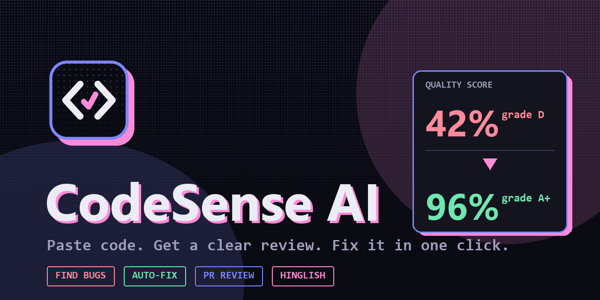

<br>

### Catch bugs before they ship. Explained simply. Fixed in one click.

<p>
  <a href="https://codesense-ai-seven.vercel.app"><b>🚀 Live demo</b></a> &nbsp;·&nbsp;
  <a href="#-screenshots">Screenshots</a> &nbsp;·&nbsp;
  <a href="#-quick-start">Quick start</a> &nbsp;·&nbsp;
  <a href="#-how-it-works">How it works</a> &nbsp;·&nbsp;
  <a href="docs/DEMO_AND_VIVA.md">Demo script</a>
</p>

<p>
  
  
  
  
  
  
</p>

<p>
  
  
  
  
</p>

</div>

---

## ✨ What is CodeSense AI?

Paste code (or a GitHub pull request) and get a **scored review**: every bug and security hole is pinned
to the exact line, explained in plain words, and fixed with **one click**. Made for **beginners who have no
senior to ask** and for **developers who want a fast second pair of eyes**.

<div align="center">
  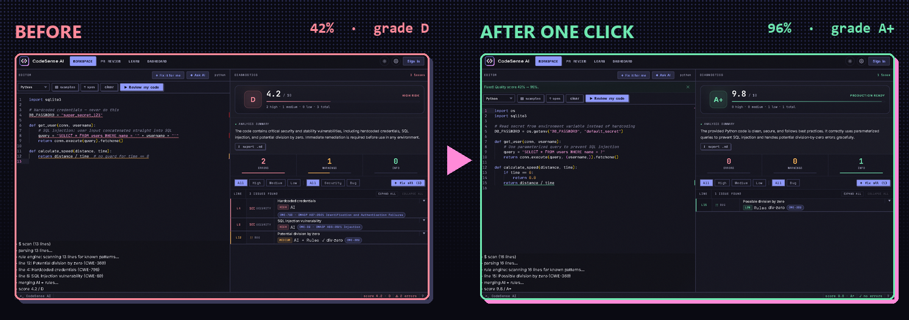
  <p><sub>The same file, reviewed, auto-fixed and re-scored. Nothing hand-edited.</sub></p>
</div>

## 🎯 Features

| | Feature | What you get |
|---|---|---|
| 🔎 | **Line-accurate review** | Issues underlined in a real Monaco (VS Code) editor, tagged with **CWE / OWASP** ids |
| 🛠️ | **Verified auto-fix** | Gemini fixes the file, then deterministic rules and a syntax check verify it (one repair retry). The score is **re-computed automatically** |
| 📊 | **Transparent score** | `10 − 2.5·high − 0.8·medium − 0.2·low`, grade **A+ to F**. The AI never decides the score |
| 🔀 | **PR review** | Paste a diff **or a public GitHub PR link**. Every AI comment is checked against lines that really changed, so made-up lines are dropped |
| 🇮🇳 | **Hinglish and Hindi** | Explanations in English, Hinglish or हिन्दी. Beginner to expert levels |
| 🎓 | **Learn mode** | Plain-language help and find-the-bug quizzes |
| 💬 | **Ask AI** | Chat about your code, explain it, generate unit tests |
| 📈 | **Dashboard** | Sign in (or use the guest account) to keep history, charts and score trends |
| 📱 | **Works on phones** | Touch editor, installable as an app (PWA) |
| 🎨 | **Dithered Lo-fi theme** | Dark and light, designed to stay readable |

## 📸 Screenshots

<table>
  <tr>
    <td width="50%">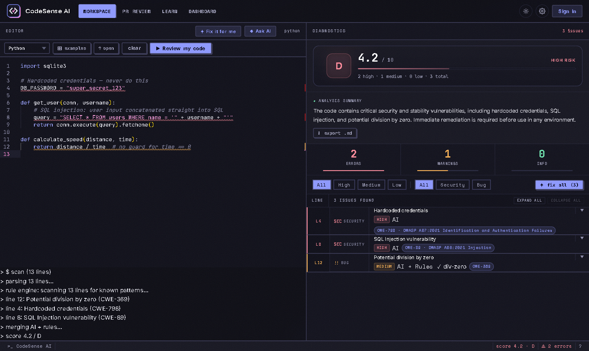<br><b>Find.</b> Score, summary and every issue with CWE and OWASP tags.</td>
    <td width="50%">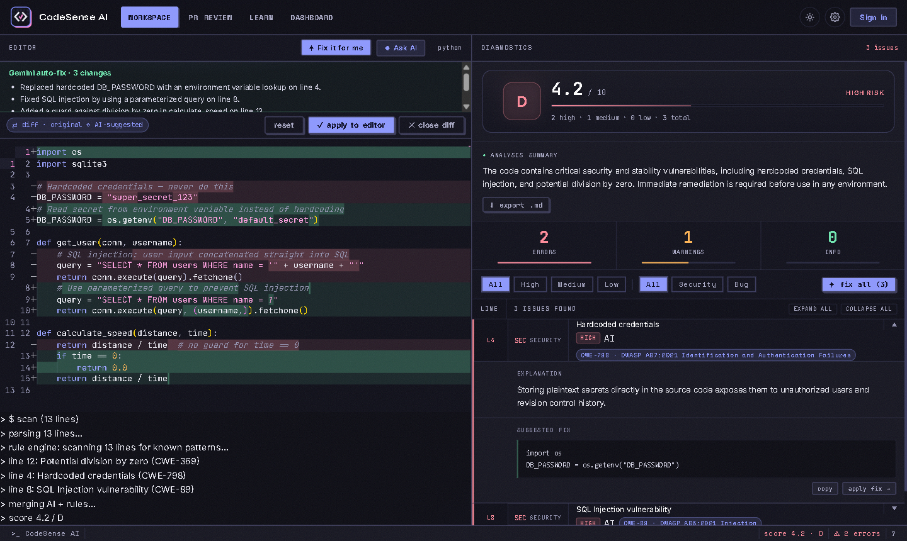<br><b>Fix.</b> Review a before/after diff, then apply it to the editor.</td>
  </tr>
  <tr>
    <td>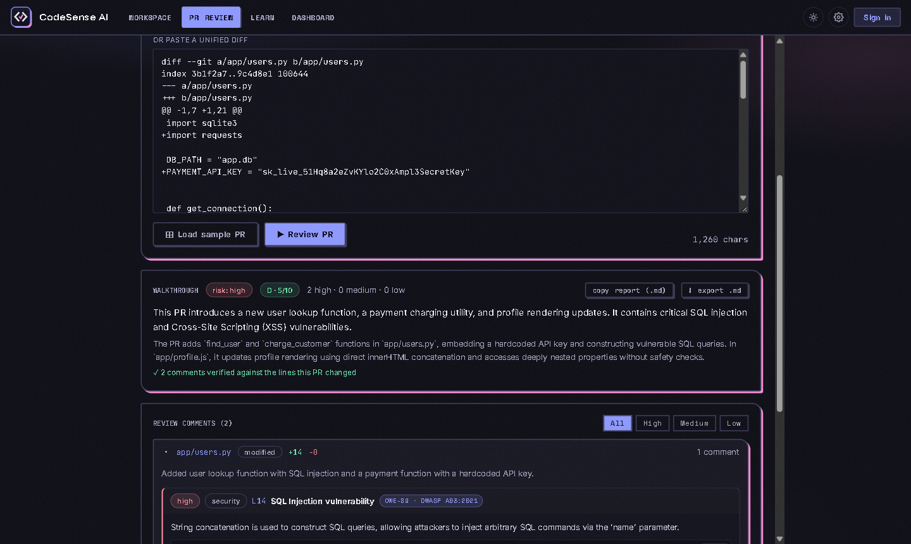<br><b>Review PRs.</b> Risk level, per-file groups and verified comments.</td>
    <td>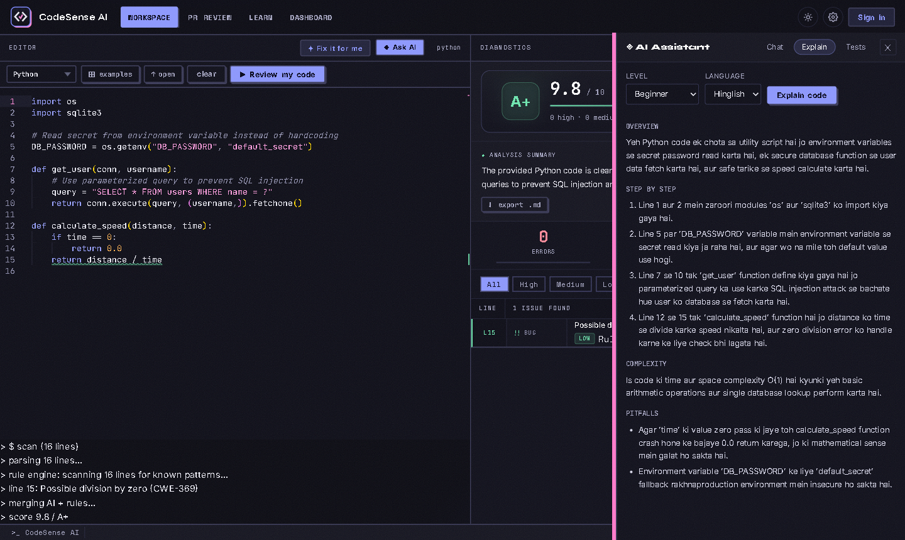<br><b>Ask AI.</b> Explanations in Hinglish, Hindi or English.</td>
  </tr>
  <tr>
    <td>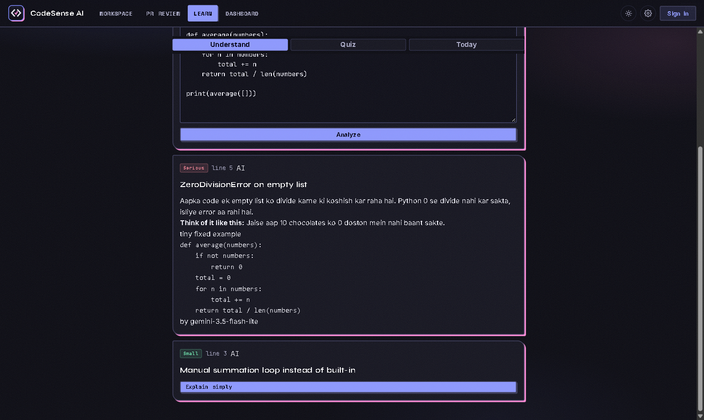<br><b>Learn.</b> Beginner-friendly explanations and quizzes.</td>
    <td>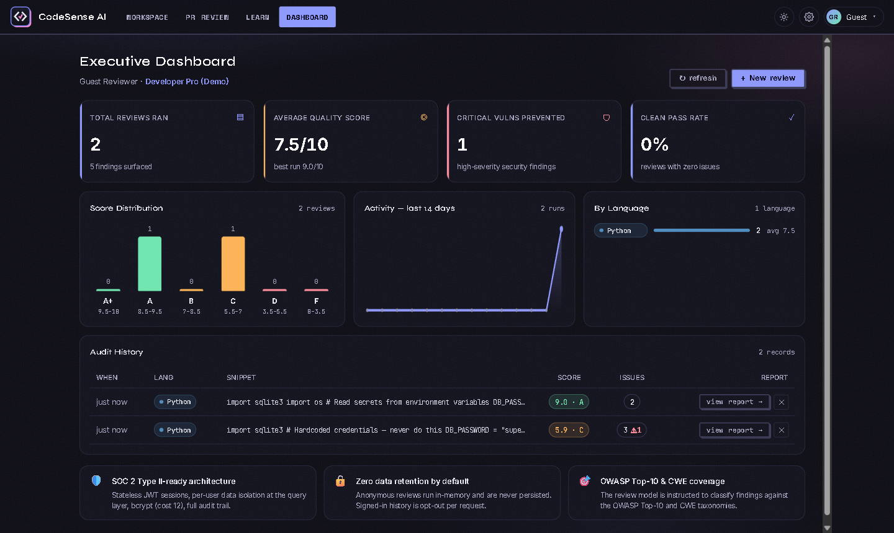<br><b>Track.</b> History, score distribution and activity.</td>
  </tr>
</table>

<details>
<summary><b>🌐 Landing page and 📱 mobile</b></summary>
<br>
<table>
  <tr>
    <td colspan="2">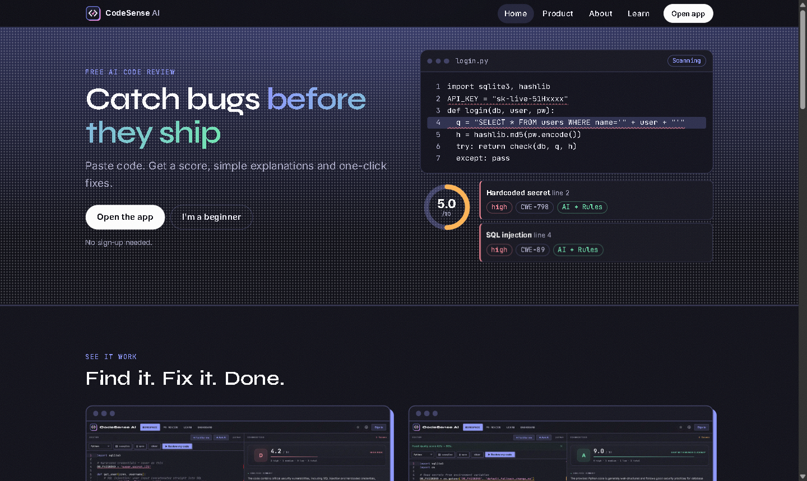</td>
  </tr>
  <tr>
    <td align="center" width="50%">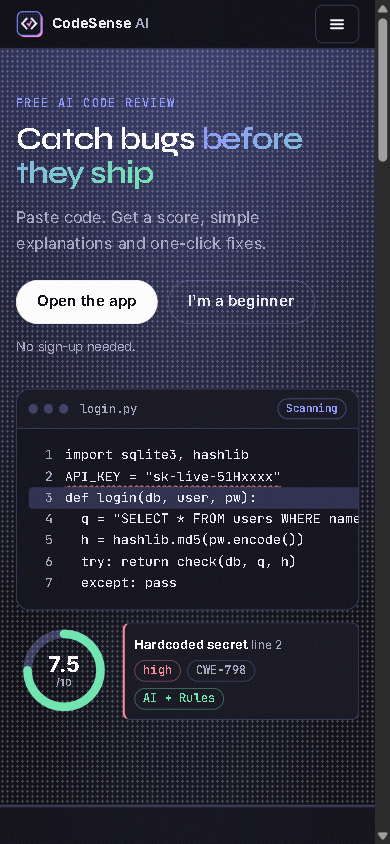</td>
    <td align="center" width="50%">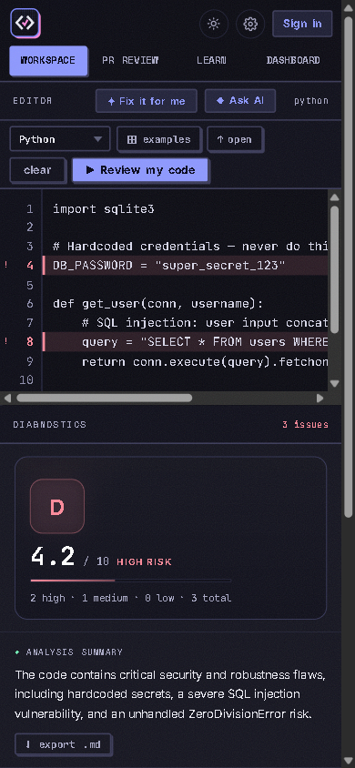</td>
  </tr>
</table>
</details>

## ⚙️ How it works

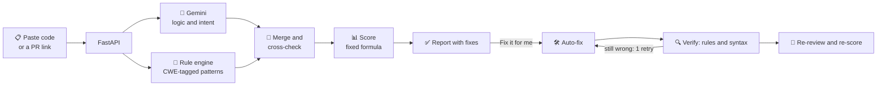

**Two engines, cross-checked.** Gemini reasons about logic and intent. A deterministic rule engine applies
fixed checks every time. Findings are merged, tagged as `AI`, `Rules` or `AI + Rules`, and scored with a
formula you can read in [`core/scoring.py`](backend/core/scoring.py).

## 🧰 Tech stack

| Layer | Tech |
|---|---|
| Frontend | React 18, Vite, Monaco editor, hand-written CSS (no UI library) |
| Backend | FastAPI, Uvicorn, Pydantic v2, async SQLAlchemy |
| AI | Google Gemini via `google-genai`, with an automatic fallback model |
| Data | PostgreSQL (Neon) in production, SQLite locally |
| Auth | bcrypt password hashing, JWT with expiry, per-user history isolation |
| Deploy | Vercel (live site), or a single Docker container |

## 🚀 Quick start

**You need:** Python 3.12+, Node 20+, and a free [Gemini API key](https://aistudio.google.com/app/apikey).

```bash
git clone https://github.com/Cod4Nitish/CodeSenseAI.git
cd CodeSenseAI

# 1. Backend  ->  http://localhost:8000
cd backend
python -m venv .venv
.venv\Scripts\activate             # macOS / Linux: source .venv/bin/activate
pip install -r requirements.txt
cp .env.example .env               # then set GEMINI_API_KEY=...
python -m uvicorn main:app --reload --port 8000

# 2. Frontend  ->  http://localhost:5173   (new terminal)
cd frontend
npm install
npm run dev
```

On Windows you can also double-click **`start.bat`** to start both and open the browser.

<details>
<summary><b>🐳 Run with Docker (one container: UI + API)</b></summary>

```bash
docker build -t codesense .
docker run -p 8080:8080 -e GEMINI_API_KEY=your_key -e SECRET_KEY=$(python -c "import secrets;print(secrets.token_urlsafe(48))") codesense
# open http://localhost:8080
```
</details>

<details>
<summary><b>🔧 Environment variables</b></summary>

| Variable | Required | Default | Notes |
|---|---|---|---|
| `GEMINI_API_KEY` | **yes** | none | Server-side only, never sent to the browser |
| `SECRET_KEY` | production | random per start | Signs login tokens. Pin it in any deployed environment |
| `DATABASE_URL` | no | local SQLite file | Use a Postgres URL in production |
| `ENVIRONMENT` | no | `development` | Set `production` when deployed |
| `GEMINI_MODEL` / `GEMINI_FALLBACK_MODEL` | no | `gemini-3.1-flash-lite` / `gemini-3.5-flash-lite` | |
| `RATE_LIMIT_ENABLED` | no | `true` | Limits analyze requests per minute |
| `DEMO_EMAIL` / `DEMO_PASSWORD` | no | none | Enables the one-click guest login |
| `VITE_API_URL` | no | `http://localhost:8000` | Frontend only, used for local dev |

See [`backend/.env.example`](backend/.env.example).
</details>

## 🔌 API

Interactive docs at `/docs` when the backend is running.

| Method | Endpoint | Purpose |
|---|---|---|
| `POST` | `/api/analyze` | Review code and get the score |
| `POST` | `/api/review-diff` | Review a pull-request diff |
| `GET` | `/api/github/pr?url=` | Fetch the diff of a public GitHub PR |
| `POST` | `/api/ai/fix` | Verified whole-file auto-fix |
| `POST` | `/api/ai/explain` | Explain code (`level`, `lang`: english, hinglish, hindi) |
| `POST` | `/api/ai/chat` · `/tests` · `/simplify` · `/quiz` | Chat, unit tests, simple explanations, quizzes |
| `POST` | `/api/auth/register` · `/login` · `/demo` | Accounts and guest login |
| `GET` | `/api/reviews` · `/api/reviews/stats` | Saved history and dashboard stats |
| `GET` | `/api/health` | Health check |

## 🧪 Tests

```bash
cd backend
pip install -r requirements-dev.txt
python -m pytest -q          # 47 tests: auth, analyze, diff parser, AI tools
```

## 🗂️ Project layout

```
backend/
  main.py                FastAPI app, middleware, serves the built UI
  routers/               analyze · diff · github · ai · auth · reviews
  services/              gemini_service · ai_tools · static_analyzer · diff_service · review_service
  core/                  scoring · diff parser · security · rate limit · config
  models/ schemas/       SQLAlchemy models and Pydantic schemas
  tests/                 pytest suite
frontend/
  src/pages/             Landing · Workspace · PRReview · Learn · Dashboard · auth
  src/components/        TopBar · CodeInput · TextEditor (mobile) · ResultsPanel · AIPanel ...
  src/themes.css         Dithered Lo-fi theme
docs/                    banner, before/after image, demo script and viva notes
screenshots/             product screenshots used above
```

## 🥊 How it compares

| | **CodeSense AI** | GitHub Copilot review | CodeRabbit | SonarQube | DeepSource |
|---|:-:|:-:|:-:|:-:|:-:|
| Works instantly, no repo setup | ✅ | ❌ | ❌ | ❌ | ❌ |
| Free to try | ✅ | ❌ | partly | partly | partly |
| Transparent, repeatable score | ✅ | ❌ | ❌ | ✅ | ✅ |
| Hinglish / Hindi explanations | ✅ | ❌ | ❌ | ❌ | ❌ |
| Beginner learn mode | ✅ | ❌ | ❌ | ❌ | ❌ |
| Native CI / GitHub app integration | ❌ | ✅ | ✅ | ✅ | ✅ |
| Whole-repo scan | ❌ | ❌ | partly | ✅ | ✅ |

<sub>Approximate and based on general public information at the time of writing. CodeSense AI is a learning
project and a fast first pass, not a replacement for a human reviewer or a full CI pipeline.</sub>

## ⚠️ Honest limitations

- AI can miss bugs or be wrong, so treat findings as suggestions. The score can vary a little between runs on the same code.
- Files are limited to 20,000 characters. Rule coverage is strongest for Python and JavaScript.
- GitHub PR import works for **public** repositories only.
- The Gemini free tier has quotas. If it is rate-limited the app shows a clear error with a **Retry** button, never fake results.

## 🗺️ Roadmap

- [ ] GitHub App that comments on pull requests automatically
- [ ] Bandit, ESLint and Semgrep alongside the AI
- [ ] Team workspaces and shareable report links
- [ ] Whole-repository scan and CI action

## 👨‍💻 Author

Built by **Nitish Singh** ([@Cod4Nitish](https://github.com/Cod4Nitish), lead developer) and **Shivam** as a
final-year project: *CodeSense AI: An AI-Powered Code and Bug Detection System*.

<div align="center">
  <sub>If this helped you, a ⭐ on the repo is appreciated.</sub>
</div>
